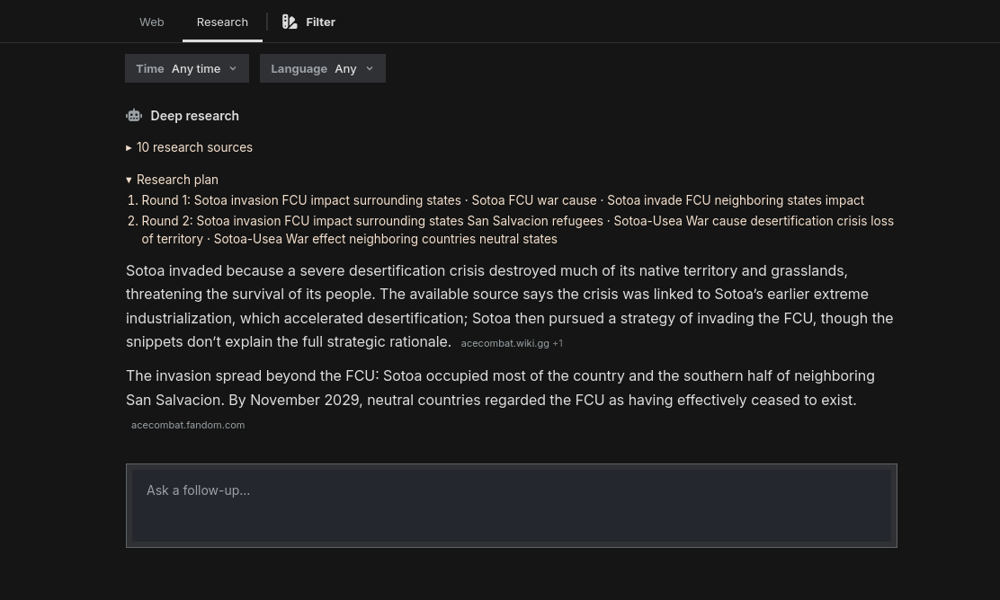

# degoog-extensions

---

Forked from the official [degoog extensions repo](https://github.com/degoog-org/degoog)

# What's here?

- **AI Research**
Fork of the official AI Summary Plugin. Shows a new "Research" tab where your query is processed by an AI into smaller steps, searches are handled by degoog itself. Then it summarizes its findings based on the results.

